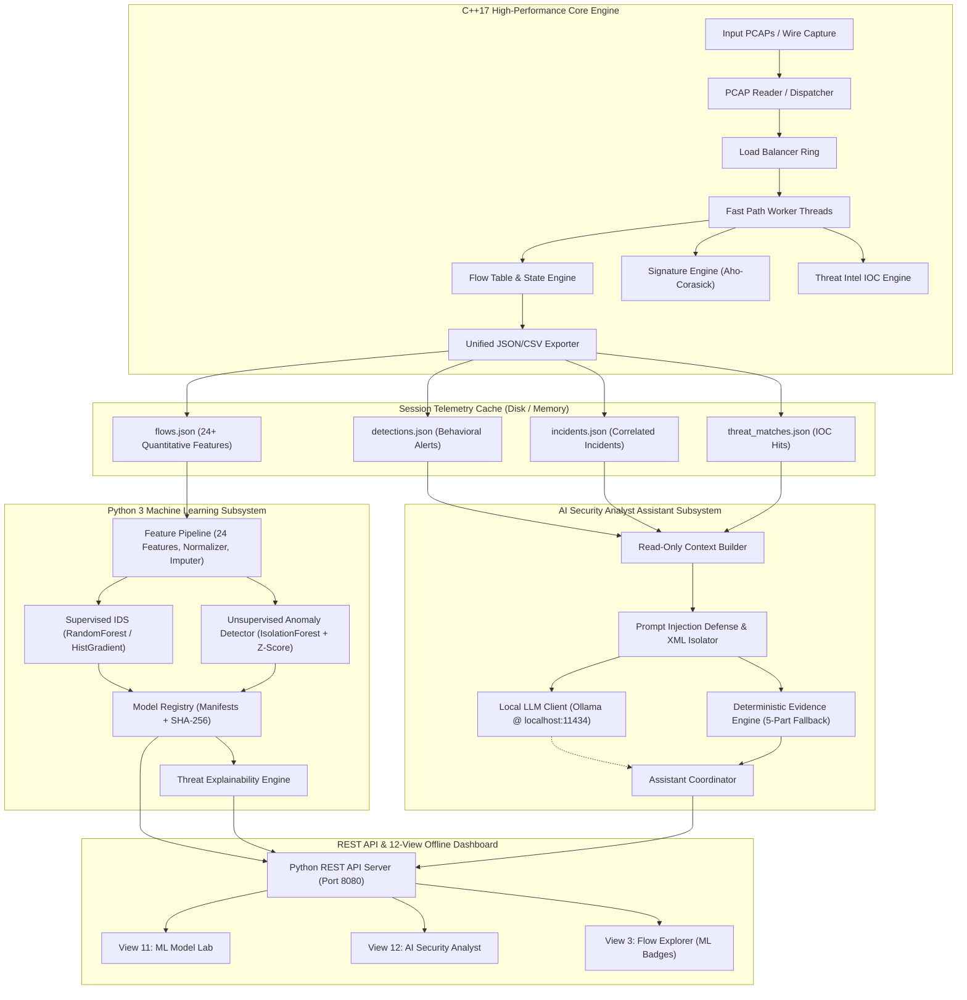
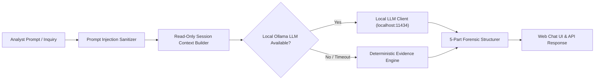

# Deep Packet Inspection & Packet Analyzer — AI Architecture Specification
**Document Version:** 5.5.0-FINAL  
**Milestone:** Milestone 5.5 — Final Project Closure & Release Engineering  
**System Target:** Production-Grade C++17 DPI Engine with Native Python AI/ML Intelligence Runtime

---

## 1. Executive Summary & Design Principles

The Deep Packet Inspection (DPI) & Packet Analyzer platform combines wire-speed C++17 packet processing with a research-grade Python 3.10+ Machine Learning and Artificial Intelligence intelligence runtime.

### Core Architectural Principles
1. **Decoupled Processing & Analysis**: The C++17 DPI engine operates autonomously at line-rate, executing fast-path packet reassembly, flow state tracking, signature matching, and behavioral heuristics without being blocked by Python execution or GIL limitations.
2. **Deterministic Evidence Priority**: Deterministic DPI detections (behavioral rules, IOC matches, signature hits) serve as ground truth and priority evidence. AI and ML models augment and correlate this data rather than blindly overriding wire-verified facts.
3. **Offline-First & Cloud-Agnostic**: Zero external cloud APIs, zero per-token charges, and zero external network dependencies. Models and assistants run strictly on localhost.
4. **Adversarial Resilience**: Network traffic payloads are treated as untrusted and potentially adversarial. Strict XML sanitization filters prevent prompt injection through captured packet fields.
5. **Transparency & Explainability**: All anomaly and intrusion verdicts are decomposable into contributing flow features and multi-factor risk attribution weights with explicit uncertainty bounds.
6. **Scientific Rigor**: Rigorous Stratified Cross-Validation with variance reporting; zero data leakage across network splits; strict feature schema versioning (`2.0.0`) prohibiting direct destination port memorization; no fabricated baseline models.

---

## 2. System Architecture Diagram



---

## 3. C++17 Engine to Python ML/AI Runtime Boundary

The platform deliberately avoids in-process Python embedding via `libpython` or `pybind11` within the high-throughput packet processing path. This design choice prevents:
- **Global Interpreter Lock (GIL) contention** across multi-threaded C++ fast path workers.
- **Memory fragmentation** caused by Python runtime object allocations.
- **Process instability**: A Python memory leak or crash cannot crash the C++ packet capture pipeline.

### Data Interchange Contracts
Communication between C++17 and Python occurs via structured, standardized file and REST IPC protocols:
- **Artifact Pipeline**: When C++ processing concludes, `ExportPipeline` serializes normalized JSON datasets (`flows.json`, `detections.json`, `incidents.json`, `threat_matches.json`) into the active session directory.
- **Dynamic Controller Execution**: The REST API server (`server/api_server.py`) can invoke the C++ engine binary (`bin/dpi_engine`) on demand via sub-process execution, monitoring stdout and reloading session cache upon exit.
- **Feature Vector Schema**: The C++ engine guarantees consistent numerical representations for flow duration, packet counts, byte counts, window sizes, TCP flags, and inter-arrival times, directly consumed by the Python `FeaturePipeline`.

---

## 4. Quantitative Feature Engineering Pipeline (24 Features — Schema 2.0.0)

The `ml/feature_pipeline.py` module transforms raw network flow records into a fixed 24-dimensional numeric feature vector under **Schema Version 2.0.0**:

| Index | Feature Key | Dimension & Unit | Description | Safety Transformation |
| :---: | :--- | :--- | :--- | :--- |
| **0** | `duration_seconds` | Seconds (>= 0.0) | Flow duration derived from start/end timestamps | Non-negative clipping |
| **1** | `total_packets` | Integer count (>= 1) | Total bidirectional packets | Minimum bound = 1 |
| **2** | `total_bytes` | Integer count (>= 0) | Total bidirectional payload and header bytes | Non-negative clipping |
| **3** | `packets_per_second` | Float (>= 0.0) | Flow packet transmission frequency | Imputed if duration < 1 ms |
| **4** | `bytes_per_second` | Float (>= 0.0) | Flow byte throughput | Imputed if duration < 1 ms |
| **5** | `byte_asymmetry_ratio`| Ratio (>= 0.0) | fwd_bytes / (rev_bytes + 1) | Laplace smoothed denominator |
| **6** | `packet_asymmetry_ratio`| Ratio (>= 0.0)| fwd_packets / (rev_packets + 1) | Laplace smoothed denominator |
| **7** | `fwd_packets` | Integer count (>= 0) | Packets transmitted in forward direction | Non-negative clipping |
| **8** | `fwd_bytes` | Integer count (>= 0) | Bytes transmitted in forward direction | Non-negative clipping |
| **9** | `rev_packets` | Integer count (>= 0) | Packets transmitted in reverse direction | Non-negative clipping |
| **10**| `rev_bytes` | Integer count (>= 0) | Bytes transmitted in reverse direction | Non-negative clipping |
| **11**| `pkt_size_min` | Float (>= 0.0) | Minimum packet length observed in flow | Non-negative clipping |
| **12**| `pkt_size_max` | Float (>= 0.0) | Maximum packet length observed in flow | Non-negative clipping |
| **13**| `pkt_size_mean` | Float (>= 0.0) | Mean packet length observed in flow | Non-negative clipping |
| **14**| `pkt_size_stddev` | Float (>= 0.0) | Standard deviation of packet lengths | Non-negative clipping |
| **15**| `iat_mean` | Microseconds (>= 0.0)| Mean packet inter-arrival time | Default = 0.0 |
| **16**| `iat_stddev` | Microseconds (>= 0.0)| Inter-arrival time standard deviation | Default = 0.0 |
| **17**| `fwd_syn_count` | Integer count (>= 0) | SYN control flag occurrences (forward) | Non-negative clipping |
| **18**| `fwd_ack_count` | Integer count (>= 0) | ACK control flag occurrences (forward) | Non-negative clipping |
| **19**| `fwd_fin_count` | Integer count (>= 0) | FIN control flag occurrences (forward) | Non-negative clipping |
| **20**| `fwd_rst_count` | Integer count (>= 0) | RST control flag occurrences (forward) | Non-negative clipping |
| **21**| `fwd_psh_count` | Integer count (>= 0) | PSH control flag occurrences (forward) | Non-negative clipping |
| **22**| `is_well_known_port`| Binary {0.0, 1.0} | Destination port < 1024 | Generalized structural indicator |
| **23**| `is_ephemeral_port` | Binary {0.0, 1.0} | Destination port >= 49152 | Generalized structural indicator |

### Pipeline Safety Guarantees & Schema 2.0.0 Enforcement
- **Strict Port & Identifier Leakage Prevention**: In Schema 2.0.0, raw `destination_port` and raw `protocol_num` are strictly forbidden and registered in `BANNED_FEATURE_FIELDS`. Feature extraction enforces generalized behavioral port ranges (`is_well_known_port` for ports < 1024, `is_ephemeral_port` for ports >= 49152) preventing models from memorizing specific port assignments (e.g., port 445 or 8080).
- **Identifier Isolation**: Source IP, Destination IP, Source Port, Protocol Strings, Timestamps, and Flow IDs are permanently barred from the ML feature vector.
- **Validation**: Any feature set containing banned keys immediately raises a `ValueError` during initialization, training, or artifact loading.
- **Imputation & Normalization**: Missing numerical values default to 0.0; infinite/NaN values are replaced before feature standardization.
- **Statistical Scaler**: A fitted `StandardScaler` standardizes features to zero mean and unit variance for models requiring normalized spaces.

---

## 5. Supervised Intrusion Detection Architecture

The supervised learning layer in `ml/models.py` categorizes network traffic flows into specific operational and threat categories:
- `BENIGN` (Normal baseline traffic)
- `PORT_SCAN` (Reconnaissance scanning)
- `C2_BEACON` (Command & Control periodic beaconing)
- `DNS_TUNNEL` (DNS data exfiltration / tunneling)
- `MALWARE_HTTP` (Malicious HTTP payload transfers)

### Model Topologies
1. **Primary: Random Forest Classifier (`RandomForestClassifier`)**
   - Ensemble of 100 decorrelated decision trees.
   - Built-in Gini feature importance calculation.
   - Robust against non-linear interactions between flag counts and byte ratios.
   - Cost-sensitive weighting (`class_weight='balanced'`) to prevent minority attack class starvation.
2. **Alternative: Histogram-Based Gradient Boosting (`HistGradientBoostingClassifier`)**
   - High-throughput gradient boosted trees utilizing integer binning.
   - Native support for large datasets with fast sub-millisecond per-batch prediction.

### Model Manifest & Artifact Verification
Trained weights are serialized using `joblib` alongside a cryptographically bound manifest:
```json
{
  "model_name": "NIDS-RandomForest",
  "version": "1.0.0",
  "algorithm": "RandomForestClassifier",
  "task": "multiclass_classification",
  "created_at": "2026-11-22T22:30:00Z",
  "features": [...],
  "feature_count": 24,
  "classes": ["BENIGN", "C2_BEACON", "DNS_TUNNEL", "MALWARE_HTTP", "PORT_SCAN"],
  "model_sha256": "8ef04b029ff10be6975f7188d12300b8...",
  "training_metadata": { ... }
}
```
During loading, `ModelRegistry` calculates the SHA-256 digest of the `.joblib` file and asserts equality against `model_sha256`, preventing tampered or corrupted weights from being executed.

---

## 6. Unsupervised Anomaly Detection Architecture

The unsupervised anomaly detection subsystem (`ml/anomaly_detector.py`) identifies novel network deviations without requiring pre-labeled attack data.

### Dual-Methodology Detection Engine
1. **Isolation Forest (`IsolationForest`)**:
   - Isolates abnormal points in multi-dimensional space by recursively splitting randomly selected features.
   - Generates raw decision scores where lower values indicate deeper isolation.
2. **Empirical Baseline Z-Score Profiler**:
   - Learns baseline feature distributions $(\mu_j, \sigma_j)$ from legitimate historical traffic.
   - For an incoming flow, calculates statistical deviation:
     $$z_j = \frac{|x_j - \mu_j|}{\sigma_j + \epsilon}, \quad Z_{\text{stat}} = \frac{1}{2}\left(\max_j z_j + \frac{1}{d}\sum_{j=1}^d z_j\right)$$
3. **Calibrated Composite Anomaly Score**:
   - The engine combines Isolation Forest scores with empirical z-score deviations into a normalized anomaly score $S_{\text{anom}} \in [0.0, 1.0]$.
   - A configurable decision threshold (default: $0.65$) triggers an alert.

### Baseline Integrity Constraint (Milestone 5.2)
- **Minimum Sample Requirement**: The anomaly detector requires a minimum of $\ge 10$ verified benign baseline flows (`MIN_BASELINE_SAMPLES = 10`) before executing `fit_baseline`.
- **Honest Insufficient Data State**: If fewer than 10 normal flows are available in the ingestion corpus (e.g. 2 benign flows), the detector refuses to fit a brittle or unrepresentative baseline. It transitions to `status: "INSUFFICIENT_BASELINE_DATA"` with `is_calibrated: False`, returns `is_anomaly: False`, and marks `score_type: "HEURISTIC_ANOMALY_INDEX"`.
- **Zero Synthetic Fabrication**: The platform strictly forbids generating fake synthetic benign traffic to artificially satisfy model calibration requirements.

### Foundational Principle: `ANOMALY != CONFIRMED MALICIOUS`
The engine adheres to an explicit operational policy:
- High anomaly scores indicate **statistical rarity**, not confirmed malicious intent.
- Anomalies are clearly tagged: `verdict: "SUSPICIOUS_ANOMALY"`, `severity: "LOW" | "MEDIUM" | "HIGH"`.
- Explanations list top contributing features (e.g., abnormally high SYN ratio or unusual byte-to-packet ratios) so human analysts can differentiate benign spikes from zero-day threats.

---

## 7. Multi-Factor Threat Explainability Engine

`ml/explainability.py` synthesizes multiple disparate signal channels into an auditable composite risk score $R \in [0.0, 100.0]$:

### Canonical Fixed-Weight Baseline Formula
$$R_{\text{fixed}} = 0.35 \cdot R_{\text{behavioral}} + 0.30 \cdot R_{\text{threat\_intel}} + 0.20 \cdot R_{\text{supervised\_ml}} + 0.15 \cdot R_{\text{anomaly}}$$

### Dynamic Active-Channel Normalization
When the unsupervised anomaly detector is offline or uncalibrated (e.g., status is `INSUFFICIENT_BASELINE_DATA` with $< 10$ normal flows), using fixed weights dampens the maximum achievable risk score to 85.0/100, which can suppress severe intrusions from reaching full 100-point critical severity.

To prevent this artificial dampening while maintaining mathematical rigor, the engine dynamically calculates `active_normalized_score`:
$$R_{\text{active}} = \frac{\sum_{i \in \text{Active}} w_i \cdot R_i}{\sum_{i \in \text{Active}} w_i}$$

Where $\sum_{i \in \text{Active}} w_i = 0.35 + 0.30 + 0.20 = 0.85$, yielding re-normalized weights:
- $w_{\text{behavioral}}' = 0.35 / 0.85 \approx 0.4118$
- $w_{\text{threat\_intel}}' = 0.30 / 0.85 \approx 0.3529$
- $w_{\text{supervised\_ml}}' = 0.20 / 0.85 \approx 0.2353$

### Comparability Trade-Offs & Architectural Governance
- **Cross-Session Comparability ($R_{\text{fixed}}$)**: The fixed-weight composite risk score is preserved in all exports and API payloads (`composite_risk_score`). It provides strict mathematical consistency across captures regardless of whether the anomaly detector was calibrated.
- **Dynamic Scale Fullness ($R_{\text{active}}$)**: The active-normalized score is provided alongside (`active_normalized_score`) and determines the discrete risk level (`risk_level: CLEAN | LOW | MEDIUM | HIGH | CRITICAL`), ensuring that severe threats are never under-categorized due to an uncalibrated statistical baseline.
- **Audit Transparency**: Telemetry payloads include `is_re_normalized`, `active_weight_sum`, and individual channel `is_active` flags so analysts can audit exact score attribution.

### Explainability Decomposition
For every analyzed flow, the engine produces:
- **Component Breakdown**: Percentage and score contribution of behavioral heuristics, IOC matches, supervised predictions, and anomaly scores (both fixed and dynamic weights).
- **Top Deviating Features**: Specific features that pushed the flow away from normal baselines.
- **Uncertainty Rating**:
  - `LOW`: Strong agreement across all detection subsystems.
  - `MEDIUM`: Partial agreement or borderline classification probabilities.
  - `HIGH`: Conflicting signals (e.g., high anomaly score but clean signatures).
- **Plain-English Analyst Summary**: Generated narrative describing the findings.

---

## 8. AI Security Analyst Assistant Architecture

The AI Assistant (`ai/assistant.py`) operates in a dual-mode topology:



### The 5-Part Forensic Reasoning Structure
Regardless of whether an LLM is active or deterministic fallback is invoked, every investigation response is formatted according to a rigid 5-part structure:
1. **Observed Facts**: Concrete telemetry observed on the wire (IPs, ports, packet counts, protocol headers).
2. **Correlated Evidence**: Correlated detections, triggered signature IDs, and threat intel IOC matches.
3. **Forensic Interpretation**: Analysis of potential attack stages, kill-chain alignment, and adversary intent.
4. **Uncertainty & Limitations**: Explicit caveats regarding visibility gaps, encryption limits, or potential false positives.
5. **Recommended Next Steps**: Prioritized, non-destructive SOC actions (endpoint isolation verification, firewall rule drafting, DNS log reviews).

### Prompt Injection Defenses
Untrusted network strings (SNI, HTTP User-Agents, DNS queries) are strictly sanitized:
- Filtered against common injection vectors (`ignore previous instructions`, `system override`, `you are now`, `DAN mode`).
- Stripped of shell meta-characters and ANSI escapes.
- Wrapped in strict XML encapsulation: `<untrusted_traffic_evidence>` with explicit system instructions prohibiting directive execution from untrusted content.

---

## 9. Hardware & Resource Footprint

| Subsystem | CPU Overhead | Memory (RAM) Footprint | Latency per Flow | Storage Required |
| :--- | :--- | :--- | :--- | :--- |
| **C++17 DPI Core** | 4 FP threads (multithreaded) | < 25 MB | < 5 microseconds | Binary: ~600 KB |
| **Python ML Engine** | Single process (on demand) | ~65 MB (scikit-learn) | 30 - 80 microseconds | Models: ~1.5 MB |
| **Local LLM (Ollama)** | Optional (GPU / Metal / CPU) | 2 - 8 GB (7B/8B Q4) | 200 - 800 ms | Model weights: ~4 GB |
| **Deterministic Fallback** | < 1% CPU | < 5 MB | < 1 ms | Code only (< 100 KB) |
